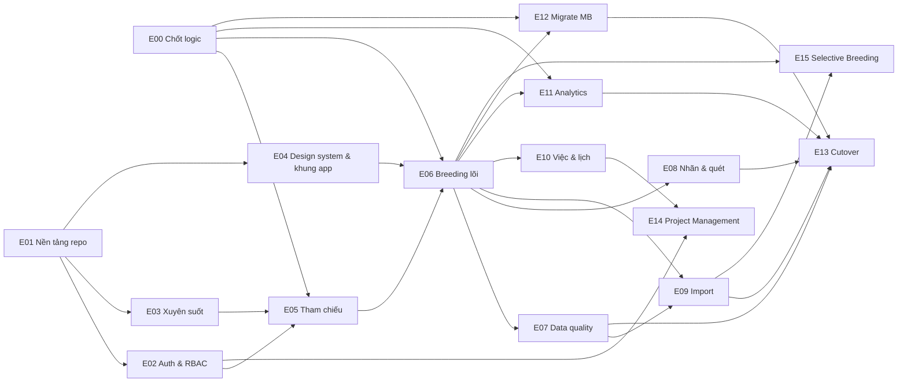

# PLAN-001 · 4 · Feature dependency map

> Phụ thuộc **giữa feature** (`03-feature-backlog.md`) và giữa epic. Mũi tên `A → B` nghĩa là B cần A xong (hoặc có giả lập rõ ràng) mới bắt đầu được.
> Dùng để: xếp wave (`05-waves.md`), tìm đường găng, chia việc song song cho nhiều người / agent.

## 1. Phụ thuộc giữa epic

**Đường găng tới cutover MB (W4):** E00 → E01 → E02 / E03 → E05 → E06 (F-0601 → F-0605 → F-0617) → E12 (F-1203 → F-1206) → E13 (F-1301 → F-1303).

## 2. Đồ thị phụ thuộc feature (rút gọn theo nhóm)

```mermaid
flowchart TB
  subgraph W0
    F0001[F-0001 Data dictionary]
    F0002[F-0002 KPI v1]
    F0003[F-0003 Chuẩn mã]
    F0004[F-0004 Fixture legacy]
    F0005[F-0005 Xác nhận trên app]
    F0006[F-0006 Protocol v1]
  end
  F0005 --> F0002
  F0001 --> F0002

  subgraph W1
    F0101[F-0101 Monorepo] --> F0102[F-0102 Compose] --> F0104[F-0104 Staging/Prod]
    F0101 --> F0103[F-0103 CI]
    F0101 --> F0201[F-0201 Entra] --> F0202[F-0202 app_user /me]
    F0101 --> F0203[F-0203 auth schema] --> F0204[F-0204 has_perm + RLS]
    F0203 --> F0205[F-0205 require + /me/permissions]
    F0205 --> F0206[F-0206 Users admin]
    F0205 --> F0207[F-0207 Roles editor]
    F0101 --> F0301[F-0301 problem+json] --> F0302[F-0302 Paging/filter]
    F0301 --> F0303[F-0303 If-Match]
    F0301 --> F0304[F-0304 Idempotency]
    F0101 --> F0305[F-0305 Audit trigger]
    F0102 --> F0306[F-0306 Job queue]
    F0204 --> F0307[F-0307 FileStorage/attachment]
    F0301 --> F0308[F-0308 Notifications/Inbox]
    F0101 --> F0309[F-0309 OpenAPI client]
    F0101 --> F0401[F-0401 Tokens] --> F0402[F-0402 AppShell]
    F0401 --> F0403[F-0403 Common components]
    F0401 --> F0404[F-0404 PWA shell] --> F0405[F-0405 Adapters] --> F0406[F-0406 Offline/outbox]
    F0304 --> F0406
    F0404 --> F0407[F-0407 Mobile components]
    F0003 --> F0501[F-0501 Reference migration] --> F0502[F-0502 Reference API]
    F0502 --> F0503[F-0503 Strains]
    F0502 --> F0504[F-0504 Generation]
    F0502 --> F0505[F-0505 Master data]
    F0006 --> F0506[F-0506 Protocol UI]
    F0002 --> F0507[F-0507 KpiDefs]
  end

  subgraph W2
    F0501 --> F0601[F-0601 Batch model]
    F0003 --> F0601
    F0601 --> F0602[F-0602 Create batch]
    F0601 --> F0603[F-0603 Batch list] --> F0604[F-0604 Batch detail]
    F0601 --> F0605[F-0605 Measurement framework]
    F0304 --> F0605
    F0205 --> F0605
    F0605 --> F0606[F-0606…F-0610 Form Egg/Neonate]
    F0605 --> F0611[F-0611 Setup/Conditions] --> F0612[F-0612…F-0614 Form Larvae/Nursery/Pupae]
    F0605 --> F0615[F-0615 Feeding]
    F0605 --> F0608[F-0608 Sexing]
    F0605 --> F0701[F-0701 DQ rules] --> F0702[F-0702 dq_issue + jobs] --> F0703[F-0703 Block close]
    F0306 --> F0702
    F0702 --> F0704[F-0704 DQ page]
    F0306 --> F0801[F-0801 Labels job]
    F0307 --> F0801
    F0801 --> F0802[F-0802 Labels page]
    F0405 --> F0803[F-0803 MScan]
    F0601 --> F0625[F-0625 Lookup/Search] --> F0803
    F0803 --> F0608
    F0506 --> F1001[F-1001 Routine templates/occurrences]
    F0306 --> F1001
    F0605 --> F1002[F-1002 done_qty in transaction]
    F1001 --> F1002
    F0605 --> F0617[F-0617 Close Egg]
    F0608 --> F0617
    F0801 --> F0617
    F1002 --> F0617
    F0703 --> F0617
    F0617 --> F0618[F-0618 Close Neonate + branch]
    F0617 --> F0619[F-0619 Close Larvae/Nursery]
    F0617 --> F0620[F-0620 Close Pupae → Egg]
    F0617 --> F0621[F-0621 Reopen 48h]
    F0605 --> F0622[F-0622 Edit/delete policy]
    F0305 --> F0622
    F0601 --> F0623[F-0623 Lineage]
    F0305 --> F0624[F-0624 History]
    F0605 --> F0901[F-0901 Import core]
    F0701 --> F0901
    F0901 --> F0902[F-0902 Wizard] --> F0903[F-0903 History/undo]
    F0902 --> F0904[F-0904 Linked import]
    F1001 --> F1003[F-1003 Việc của tôi] --> F1004[F-1004 RoutineSchedule]
    F0308 --> F1003
    F0617 --> F0626[F-0626 E2E M2]
    F0620 --> F0626
  end

  subgraph W3
    F0601 --> F1101[F-1101 analytics views + parity]
    F0002 --> F1101
    F0004 --> F1101
    F1101 --> F1102[F-1102 Dashboard]
    F1101 --> F1103[F-1103 Analytics]
    F1101 --> F1104[F-1104 Export]
    F1003 --> F1105[F-1105 Home by role]
    F0703 --> F1105
    F0102 --> F1201[F-1201 legacy schema/load]
    F0004 --> F1201
    F1201 --> F1202[F-1202 Transform master] --> F1203[F-1203 Transform batch/lineage] --> F1204[F-1204 Transform measurements]
    F0601 --> F1203
    F1201 --> F1205[F-1205 audit/labels/docs]
    F1204 --> F1206[F-1206 KPI reconciliation]
    F1101 --> F1206
    F1204 --> F1207[F-1207 Incremental re-sync]
  end

  subgraph W4
    F1206 --> F1301[F-1301 Parallel run]
    F0626 --> F1301
    F0409[F-0409 Documentation] --> F1302[F-1302 Training]
    F1207 --> F1303[F-1303 Cutover runbook]
    F0107[F-0107 Secrets] --> F1303
    F0104 --> F1304[F-1304 Prod hardening]
    F0105[F-0105 Backup] --> F1304
    F1303 --> F1305[F-1305 Hypercare]
  end

  subgraph W5
    F0601 --> F1401[F-1401 PM model]
    F0204 --> F1401
    F1401 --> F1402[F-1402 Projects]
    F1401 --> F1403[F-1403 Tasks]
    F1003 --> F1403
    F1403 --> F1404[F-1404 Data task ⇄ batch]
    F1002 --> F1404
    F1401 --> F1405[F-1405 Messages]
    F0308 --> F1405
    F1403 --> F1406[F-1406 Mobile task]
    F1405 --> F1406
    F0307 --> F1407[F-1407 Files/Drive]
    F1401 --> F1408[F-1408 PM dashboard/report]
    F0306 --> F1408
    F1401 --> F1409[F-1409 PM privacy RLS]
    F1201 --> F1410[F-1410 Migrate PM]
    F1401 --> F1410
  end

  subgraph W6
    F0002 --> F1501[F-1501 SB logic]
    F1501 --> F1502[F-1502 SB reference] --> F1503[F-1503 SB clutch forms]
    F0605 --> F1503
    F1502 --> F1504[F-1504 SB batches/larva_weight]
    F0618 --> F1504
    F1504 --> F1505[F-1505 Phenotyping]
    F0901 --> F1505
    F1504 --> F1506[F-1506 Selection run] --> F1507[F-1507 Allocation]
    F1101 --> F1508[F-1508 SB overview]
    F1503 --> F1508
    F1503 --> F1509[F-1509 Migrate SB Excel]
    F1504 --> F1509
    F1201 --> F1509
  end
```

## 3. Bảng phụ thuộc chi tiết (chỉ các cạnh quan trọng)

| Feature | Cần trước | Lý do | Có thể làm song song với |
|---|---|---|---|
| F-0002 KPI v1 | F-0005 xác nhận trên app, F-0001 | Hatching / pupae survival / avg_baby_mass đang mâu thuẫn giữa 3 nguồn | F-0003, F-0004, F-0006 |
| F-0601 Batch model | F-0501, F-0003 | FK tới tham chiếu; mã sinh ở server | F-02xx, F-03xx, F-04xx |
| F-0605 Measurement framework | F-0601, F-0304, F-0205 | id client sinh, quyền form | F-0602…F-0604 |
| F-0608 Sexing | F-0605, F-0803 (quét cốc) | Mobile quét `…_BB.n` mở đúng cá thể; web làm trước không cần F-0803 | F-0606, F-0607 |
| F-0617 Close Egg | F-0605, F-0608, F-0801, F-1002, F-0703 | Gate pending individuals, DQ error, yêu cầu nhãn, huỷ / sinh routine trong cùng transaction | Có thể stub `work.public` và `labels.enqueue` để làm sớm |
| F-0620 Close Pupae → Egg | F-0617, F-0602 | Tạo nhiều batch Egg = dùng use case tạo batch | F-0618, F-0619 |
| F-0901 Import | F-0605, F-0701 | Validate từng dòng dùng chung domain + DQ | F-08xx, F-10xx |
| F-1101 Views | F-0601, F-0002, F-0004 | Parity test cần fixture + định nghĩa ký | F-07xx…F-10xx |
| F-1203 Transform batch | F-1202, F-0601 | Schema core phải ổn định (migration đã merge) | F-1101 |
| F-1206 Reconciliation | F-1204, F-1101, F-0007 | So KPI view với giá trị AppSheet | — |
| F-1301 Parallel run | F-1206, F-0626, F-0104 | Staging có dữ liệu migrate + app chạy trọn chu trình | F-1302 |
| F-1303 Cutover | F-1207, F-0107, F-1301 sign-off | Import lần cuối + rotate secret | — |
| F-1404 Data task | F-1403, F-1002 | `done_qty` đếm từ bản ghi | F-1405, F-1407 |
| F-1503 SB clutch | F-1502, F-0605 | Dùng `egg_clutch` + measurement framework | F-1504 |
| F-1506 Selection | F-1504, F-1505 | Index cần survival, dry FCR, ngày thu từ larvae batch | F-1507 sau |

## 4. Nhóm làm song song (không phụ thuộc nhau)

| Nhóm | Feature | Ghi chú |
|---|---|---|
| S1 (W0) | F-0001, F-0003, F-0004, F-0006, F-0007 | F-0005 nên làm sớm nhất vì chặn F-0002 |
| S2 (W1, backend) | F-0201…F-0205, F-0301…F-0306, F-0309 | Sau F-0101 |
| S3 (W1, frontend) | F-0401…F-0408 | Sau F-0101; dùng MSW giả API |
| S4 (W1, reference) | F-0501…F-0507 | Sau F-0203, F-0301 |
| S5 (W2, form Egg / Neonate) | F-0606, F-0607, F-0609, F-0610 | Sau F-0605; web và mobile tách người |
| S6 (W2, form Larvae / Nursery / Pupae) | F-0612, F-0613, F-0614, F-0615 | Sau F-0611 |
| S7 (W2, cross) | F-07xx, F-08xx, F-09xx, F-10xx | Sau F-0605; stub chỗ nối với close |
| S8 (W3) | F-1101…F-1104 ∥ F-1201…F-1205 | Analytics và migrate độc lập tới F-1206 |
| S9 (W5 / W6) | E14 ∥ E15 | Độc lập; cùng cần E06, E10 |

## 5. Phụ thuộc vào quyết định (D / DN)

| Quyết định | Chặn feature | Giá trị mặc định để không chặn |
|---|---|---|
| D1 Thời điểm cutover | F-1301, F-1303 | Go-live AppSheet 04/01/2027, cutover sau hypercare 05/02/2027 |
| D2 Model chung MB + SB | F-0601, F-1501 | Model chung |
| D3 Nơi chạy | F-0104 | Server nội bộ, Compose |
| D4 Lưu file | F-0307 | Ổ server qua interface |
| D5 Task data tự Completed | F-1404 | Tự Completed; `review` → Under review |
| D6 Lịch việc định kỳ | F-0006, F-1001 | Ví dụ blueprint, Executive nhập lại |
| D7 Công thức KPI | F-0002, F-1101, F-1206 | Theo ERD / Excel |
| D8 Thiết bị | F-0404, F-1302 | Android Chrome hiện hành, iOS Safari 16.4+ |
| DN-1…DN-9 (mới, xem `06`) | ghi tại từng mục | |
