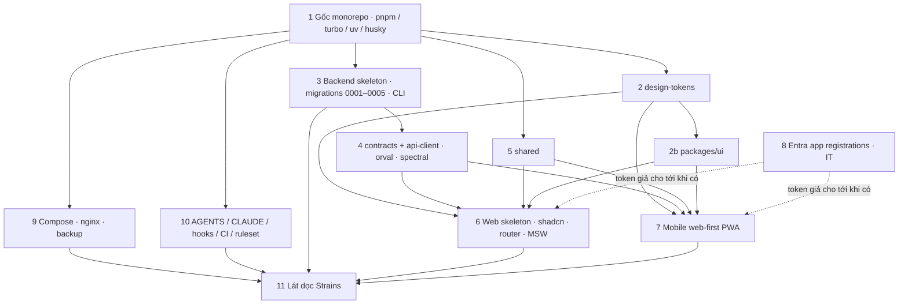

# Dependency map · khởi tạo

> Thứ tự phụ thuộc giữa các bước của `setup-guide.md` và các feature E01–E05 của PLAN-001. Dùng để PLAN-003 xếp task song song cho 3 agent.

## Song song cho agent

| Agent | Bước sở hữu | Cần trước | Có thể bắt đầu ngay sau |
|---|---|---|---|
| Claude Planner | 1, 2, 2b (khung `packages/ui`), 5 (khung), 9, 10 | — | ngày 1 |
| Codex | 3, 4 (phần export + spectral), 8 (hướng dẫn IT) | 1 | ngày 1 (song song với Planner, trên nhánh riêng) |
| Claude web | 6, 4 (orval + mutator), 11 (web) | 1, 2, 4 (spec rỗng cũng chạy được orval) | ngày 2 |
| Claude mobile | 7, 11 (mobile) | 1, 2, 2b, 4 | ngày 2 |

## Map tới feature PLAN-001

| Bước | Feature |
|---|---|
| 1 | F-0101, F-0103 (khung CI) |
| 2, 2b | F-0401 (tokens + `packages/ui`) |
| 3 | F-0101 (backend), F-0301, F-0303, F-0304, F-0305, F-0306 (khung Procrastinate), F-0203 (seed), F-0501 (migration) |
| 4 | F-0309, một phần F-0301 (schema Problem) |
| 5 | F-0310 |
| 6 | F-0402, F-0403 (khung), F-0408 |
| 7 | F-0404, F-0405, F-0406 (khung store / outbox), F-0407 |
| 8 | F-0201, F-0202 |
| 9 | F-0102, F-0104 (staging), F-0105 (script), F-0107 |
| 10 | ADR-0014, F-0103 |
| 11 | F-0502, F-0503 (tối thiểu) — mẫu vàng |

## Quyết định chặn

OQ-1, OQ-2, OQ-4, OQ-5, OQ-6, OQ-8 đã chốt 26/10/2026. Còn OQ-3 (IT) chặn bước 8 thật (token giả thay thế ở local) và OQ-16 (tên thư mục, mặc định `apps/`, `services/`).
